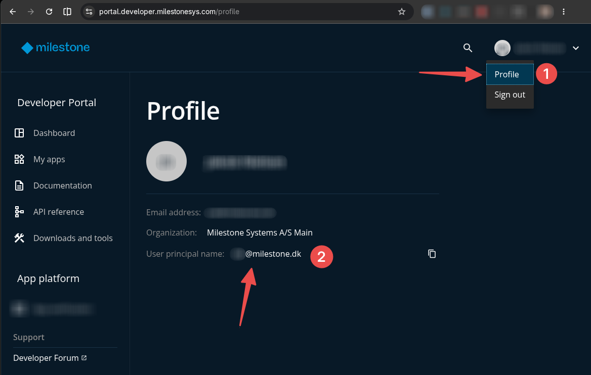

# Module 1: Set Up Your Workspace

**Duration:** ~20 minutes

**Goal:** the workshop folder running in the dev container, with your AI agent logged in, access to Milestone's npm packages, and a connection to the shared App Platform.

## Step 1: Clone the workshop repository and open it in VS Code

In a terminal on your machine (on Windows, a WSL terminal), clone the repository into your home directory, change to the `developer-summit-2026` folder and open it in VS Code:

```bash
cd ~
git clone https://github.com/milestonesys/appcenter-workshops.git
cd appcenter-workshops/developer-summit-2026
code .
```

> 💡 Already cloned it for the [prerequisites](../PREREQUISITES.md)? Then just run `cd ~/appcenter-workshops/developer-summit-2026 && git pull && code .` instead.

This `developer-summit-2026` folder is your **workshop folder**. Everything you do in the following modules happens in here.

VS Code offers to **Reopen in Container**. If you want to add an AI agent in Step 2, don't click it yet. The configuration has to be edited first, and the container then has to be rebuilt.

## Step 2 (optional): Add your AI agent

Skip this step if you don't want an AI agent in the container.

Open `.devcontainer/devcontainer.json`. Under `"features"`, uncomment the line for your agent (OpenCode, Copilot CLI, Claude Code, Codex or Gemini). Save the file.

> ⚠️ Don't change anything else in the file. The mount settings are what make App Builder work from inside the container.

> 💡 Already inside the container? Edit the file there. The change is applied when you rebuild the container in Step 3.

## Step 3: Rebuild and reopen in the dev container

Open the Command Palette (**Ctrl+Shift+P** / **Cmd+Shift+P**) and run **Dev Containers: Rebuild and Reopen in Container** (or **Dev Containers: Rebuild Container** if you're already inside the container).

> ⚠️ If you added an AI agent in Step 2, you **must rebuild**. A plain **Reopen in Container** reuses the container you created for the [prerequisites](../PREREQUISITES.md) smoke test, which doesn't have your agent installed. Features are only added when the container is built.

If you didn't add an agent, **Reopen in Container** is enough.

Then open a terminal in VS Code (**Terminal → New Terminal**). From now on, run every command in this terminal, which is inside the container. It starts in your workshop folder.

## Step 4: Log in to your agent

Skip this step if you didn't add an agent in Step 2.

Start your agent and follow its login prompt. Logins from your host don't carry over into the container. Then exit the agent again.

| Agent | Start with | How to authenticate |
| --- | --- | --- |
| Claude Code | `claude` | [Claude Code authentication](https://code.claude.com/docs/en/authentication) |
| GitHub Copilot CLI | `copilot`, then `/login` | [Authenticate Copilot CLI](https://docs.github.com/en/copilot/how-tos/copilot-cli/set-up-copilot-cli/authenticate-copilot-cli) |
| OpenAI Codex | `codex login` | [Codex authentication](https://developers.openai.com/codex/auth) |
| Gemini CLI | `gemini` | [Gemini CLI authentication](https://geminicli.com/docs/get-started/authentication/) |
| OpenCode | `opencode` | No login needed for the free models. To use your own provider, run `opencode auth login`. See [OpenCode providers](https://opencode.ai/docs/providers/) |

## Step 5: Authenticate npm

Milestone's `@milestone` npm packages need a login. Run:

```bash
npm-auth
```

Log in with your **Developer Portal** account: your UPN (User Principal Name) and your password. The password isn't echoed while you type.

To find your UPN, log in to the [Developer Portal](https://portal.developer.milestonesys.com/), open the menu in the top-right corner and choose **Profile** (1). Your UPN is shown as **User principal name** (2). Use the copy button next to it.



> 🙋 **No Developer Portal account?** Raise your hand. An instructor will give you a **temporary account** for the npm registry for the workshop.

The token lasts 12 hours. If you get `401` errors later, run `npm-auth` again.

📖 For more information, see the [npm authentication guide](https://portal.developer.milestonesys.com/docs/npm-auth-guide) on the Developer Portal.

## Step 6: Verify access to the npm registry

```bash
npm view @milestone/create-mfe-app version
```

This should print a version number. If you get a `401` or `404` error instead, run `npm-auth` again and check your username and password.

## Step 7: Connect to the App Platform

Log in with the App Platform details from your handout:

```bash
app-builder login
app-builder list
```

`app-builder list` shows the apps in the shared sandbox, possibly including other participants' apps.

## Step 8: Pick your app name

The App Platform is shared by everyone in the room, so your app needs a **unique name**. You'll use this name throughout the rest of the workshop: when you generate the MFE, as the project folder name, and when you build and deploy.

Your app name is your **initials** plus `-health-dashboard`, using lowercase letters, digits and hyphens only. Check `app-builder list` to make sure nobody else has taken it.

> ⚠️ The following modules use `jd-health-dashboard` as an **example only**. Whenever you see `jd-health-dashboard`, replace it with **your own** app name.

Write your app name down. You'll need it in Module 2.

## ✅ Done when

- [ ] VS Code has your workshop folder (`developer-summit-2026`) open in the dev container
- [ ] Your agent starts and is logged in (if you added one)
- [ ] `npm view @milestone/create-mfe-app version` prints a version
- [ ] `app-builder list` works
- [ ] You have a unique app name

➡️ **[Module 2: Scaffold Your MFE](../module-2-create-mfe/README.md)**
