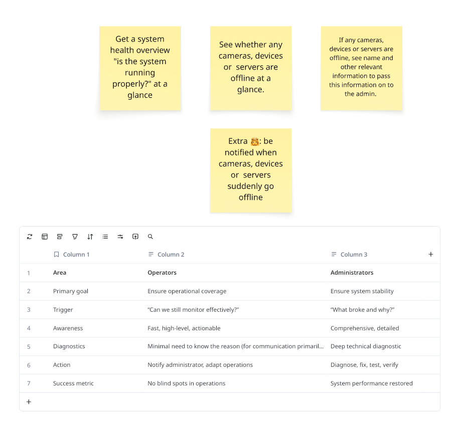

# Module 3: Build the Feature with Your AI Agent

**Duration:** ~55 minutes

This is the heart of the workshop. You'll pick a real user story, turn it into a good prompt, and work with your AI agent to build it, the way you saw in the talk.

## 🎯 Learning Objectives

By the end of this module, you will:
- ✅ Understand who you're building for: the XProtect **operator**
- ✅ Have written a structured prompt from a user story
- ✅ Have iterated with your agent (plan → build → review → run) to complete the story
- ✅ Know how the Milestone MCP server and skills help the agent produce on-brand, working MFE code

## 📋 Prerequisites

- [Module 2](../module-2-create-mfe/README.md) completed
- Your MFE running locally (`npm start` in `client/`)
- Your agent started from the project root with the Milestone MCP server connected

## 🧭 The Material: Who Are We Building For?

These user stories come from Milestone's Operator value stream and are based on real user research.



### The User Stories

As an **operator**, I want to...

| # | User story | Difficulty |
| --- | --- | --- |
| **1** | ...get a **system health overview** ("is the system running properly?") **at a glance**. | ⭐ Start here |
| **2** | ...see **whether any cameras, devices or servers are offline**, at a glance. | ⭐⭐ |
| **3** | ...if any cameras, devices or servers are offline, see their **name and other relevant information** so I can pass it on to the administrator. | ⭐⭐ |
| **4** | *Extra 👑:* ...be **notified** when cameras, devices or servers **suddenly go offline**. | ⭐⭐⭐ Stretch |

### Operators vs. Administrators

The table shows insights from user studies. **Our user is the operator**, and that should shape your UI choices: fast, high-level, actionable. No deep diagnostics.

| Area | **Operators** 👈 our user | Administrators |
| --- | --- | --- |
| Primary goal | Ensure operational coverage | Ensure system stability |
| Trigger | *"Can we still monitor effectively?"* | *"What broke and why?"* |
| Awareness | Fast, high-level, actionable | Comprehensive, detailed |
| Diagnostics | Minimal need to know the reason (mainly for communication) | Deep technical diagnostics |
| Action | Notify administrator, adapt operations | Diagnose, fix, test, verify |
| Success metric | No blind spots in operations | System performance restored |

> 💡 **Design hint:** an operator glancing at your dashboard should know within **2 seconds** whether there's a blind spot. Think "big green/red status first, details on demand".

## 🚀 Step-by-Step Instructions

### Step 1: Pick Your Story (2 minutes)

- **New to AI-assisted coding?** Start with **Story 1**, then add Story 2.
- **Comfortable?** Do Stories **1 + 2 + 3**. They build naturally on each other: overview → what's offline → details to pass on.
- **Done early?** Go for the [stretch goals](#-stretch-goals).

### Step 2: Write Your Prompt (8 minutes)

A good prompt for an agent is like a good ticket for a colleague: **who**, **what**, **what "done" means**, and **constraints**. Copy this template into a scratch file (e.g. `prompt.md`) and fill in the blanks:

```markdown
## Context
I'm building a micro frontend (MFE) for the Milestone XProtect App Platform.
The project was generated with @milestone/create-mfe-app; the MFE lives in `client/`
and `client/src/App.tsx` is the entry component. It will be shown inside XProtect Smart Client.

## User
<Who is the user? What do they care about? Use the Operators column of the table.>

## User story
As an operator, I want to <story>, so that <why it matters to them>.

## Acceptance criteria
- <Observable behaviour 1>
- <Observable behaviour 2>
- <What happens when everything is fine / when something is wrong / when data can't be loaded>

## Constraints
- Use the Milestone MCP server to look up how to get the data from XProtect/App Platform. Don't guess APIs.
- Follow the Milestone look & feel: use MUI components as-is, with @milestone/design-tokens and
  @milestone/ui-assets (use the Milestone look-and-feel skill).
- Read-only: never change any XProtect configuration.
- Put data access behind a small service/hook, so the UI can run on mock data in standalone mode.
- Keep it simple: no new dependencies unless you ask me first.

## How to work
Before writing code, ask me any clarifying questions, then show me a short plan.
Work in small steps and tell me how to verify each step in the browser.
```

<details>
<summary>📄 <b>Worked example: Story 1 (System health overview)</b>. Try writing your own first, then compare.</summary>

```markdown
## Context
I'm building a micro frontend (MFE) for the Milestone XProtect App Platform.
The project was generated with @milestone/create-mfe-app; the MFE lives in `client/`
and `client/src/App.tsx` is the entry component. It will be shown inside XProtect Smart Client.

## User
An XProtect operator in a control room. They are not technical administrators.
Their question is "Can we still monitor effectively?". They need fast, high-level,
actionable information, and they act by notifying the administrator, not by fixing things.

## User story
As an operator, I want to get a system health overview at a glance,
so that I immediately know whether the system is running properly and I have no blind spots.

## Acceptance criteria
- At the top, one clear overall status: "All systems operational" (success colour)
  or "Attention needed" (error colour), with an icon. Readable from across the room.
- Below it, one summary card per category: Cameras, Devices, Servers. Each card shows
  "<online> / <total> online" and turns to the error colour if anything is offline.
- Shows when the data was last updated, and refreshes automatically every 30 seconds.
- While loading: a skeleton/loading state. If data can't be loaded: a clear, non-technical
  error message and a "Retry" button. Never a blank screen.
- Works in both light and dark theme.

## Constraints
- Use the Milestone MCP server to look up how to get the data from XProtect/App Platform. Don't guess APIs.
- Follow the Milestone look & feel: use MUI components as-is, with @milestone/design-tokens and
  @milestone/ui-assets (use the Milestone look-and-feel skill).
- Read-only: never change any XProtect configuration.
- Put data access behind a `useSystemHealth()` hook backed by a service module. Provide a mock
  implementation that is used in standalone mode (`npm start`), so I can develop without the shell.
- Keep it simple: no new dependencies unless you ask me first.

## How to work
Before writing code, ask me any clarifying questions, then show me a short plan.
Work in small steps and tell me how to verify each step in the browser.
```

</details>

> **TODO:** Instructors: confirm which API the MFE should use for camera/device/server status (e.g. XProtect REST API via the API Gateway) and how it authenticates inside the shell. Then add a one-line hint here so agents don't go down a dead end.

### Step 3: Plan with Your Agent (5 minutes)

Paste your prompt into the agent. Then:

1. **Answer its questions.** This is where you steer. Push back if the plan looks too big.
2. **Review the plan.** Does it use the MCP server for the API? Does it use MUI + design tokens? Is data access separated from UI?
3. Only then let it start coding.

> 💡 Many agents have a **plan mode** (e.g. `Shift+Tab` in Claude Code, `/plan` in others). Use it, so the agent can't edit files until you agree on the plan.

### Step 4: Build in Small Steps (30 minutes)

Work in a loop:

```
   ┌──────────► 1. Agent implements ONE step
   │                     │
   │            2. You review the diff (VS Code Source Control view)
   │                     │
   │            3. Check it in the browser (localhost:3003)
   │                     │
   └─────────── 4. Give feedback: what's wrong, what's next
```

**Tips that make a big difference:**

- 🔎 **Commit when it works.** Run `git init` once in the project root, then `git commit -am "story 1 works"` after each green step. Now you can always roll back what the agent did.
- 🧪 **Ask for checks.** *"Run `npm run type-check` in `client/` and fix any errors."*
- 🖼️ **Be specific with visual feedback.** "The status should be the first thing I see, bigger, and use the success token colour" beats "make it nicer".
- 📚 **Make it use the tools.** If the agent invents an API or hard-codes colours: *"Look this up with the Milestone MCP server"* / *"Use the look-and-feel skill and design tokens instead of hex colours."*
- 🧹 **Reset when stuck.** If the conversation goes in circles, roll back with git, start a fresh session, and give a sharper prompt.
- ⏱️ **Keep moving.** About **25 minutes in**, make sure you have something working to deploy in Module 4. Polish can come later.

### Step 5: Check Against the Story (5 minutes)

Before you move on, check your work against the "done" criteria:

| Story | Done when... |
| --- | --- |
| **1** Overview | One glance tells you "OK" or "not OK". Counts per category. Loading and error states. Auto-refresh. |
| **2** What's offline | Offline cameras/devices/servers are listed or highlighted, and it's obvious when the list is empty ("No blind spots 🎉"). |
| **3** Details | For each offline item: name, type, location/server and how long it's been offline. Easy to **copy** or **share** with the administrator (e.g. a "Copy details" button). |

Then ask your agent for a final review:

> *"Review the changes against the user story and acceptance criteria. List anything missing, any hard-coded colours or spacing that should use design tokens, and anything that would break when loaded in the shell instead of standalone."*

Fix what matters, commit, and you're ready to deploy.

## 👑 Stretch Goals

Finished early? Pick one:

- **Story 4: Notifications.** Notify the operator when something *changes* from online to offline, e.g. an MUI `Snackbar`/`Alert`. Only notify on change, not on every refresh. *Bonus:* a sound or browser notification (ask the user for permission first).
- **Live updates through a BFF.** Let the Express server in `server/` poll XProtect and push status changes to the MFE over a **WebSocket**, instead of every client polling. This is the "backend-for-frontend" pattern, and the server is already deployed alongside your MFE.
- **Write tests.** Ask the agent for Jest + React Testing Library tests for the overview, with token-based assertions.
- **Polish for the control room.** Dark theme check, larger typography for wall displays, keyboard navigation.

## 🔍 Verification Checklist

- [ ] At least **Story 1** works in the browser (standalone)
- [ ] It uses MUI components and Milestone design tokens (no hard-coded hex colours)
- [ ] Loading and error states are handled
- [ ] `npm run type-check` passes in `client/`
- [ ] Your work is committed to git

## 🛠️ Troubleshooting

**The agent invents APIs or endpoints that don't exist**
- Check that the MCP server is connected (Module 2, Step 4) and tell the agent explicitly to use it.

**The UI doesn't look like Milestone**
- Ask the agent to use the Milestone look-and-feel skill, and to replace custom `sx` styling with standard MUI components and design tokens.

**Blank page after the agent's changes**
- Open the browser dev tools console. Paste the error into the agent.
- If it's a mess, `git checkout .` takes you back to your last commit.

**Real data won't load in standalone mode**
- That's expected if the API needs the shell's authentication. Make sure the mock implementation works, and verify real data in Smart Client in Module 4.

**Your agent is slow or hitting rate limits**
- Shorter prompts, fewer files in context, a fresh session. On free models, keep the steps extra small.

## ➡️ Next Steps

Continue to **[Module 4: Deploy and See It in Smart Client](../module-4-deploy/README.md)**.

---

**Need help?** Raise your hand. An instructor will come by.
