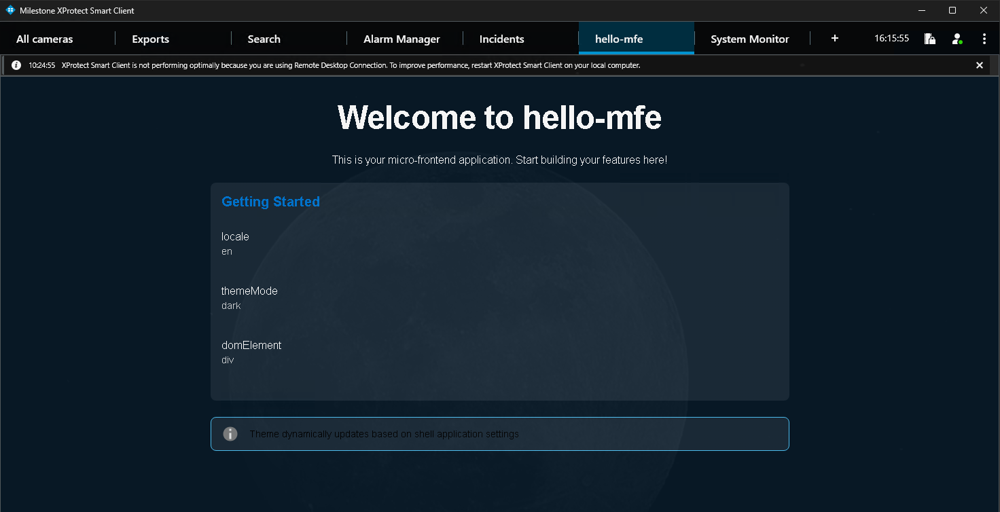

# Module 3: Deploy and See It in Smart Client

**Duration:** ~25 minutes

**Goal:** your MFE installed on the shared App Platform and running in Smart Client.

You'll ship the MFE you generated in Module 2 as it is, so you see the whole path from code to Smart Client once. In Module 4 you'll improve it with your AI agent and ship a new version.

Deploying an app takes two things:

1. A **container image** with your MFE, pushed to the sandbox registry.
2. An **app definition**, pushed to the App Platform, which tells it which image to run and where the MFE is.

Each step takes several long commands with your app name and version in them. **You don't have to type them.** The workshop folder has a [`Taskfile.yml`](../Taskfile.yml) for [Task](https://taskfile.dev), so each step is one short command, such as `task image`, and Task runs the real commands for you.

The tasks don't hide anything. Task **prints every command before it runs it**, with your app name and version filled in, and you see its output. Lines starting with `task: [...]` are the commands it runs. Read them as you go: they're the `docker` and `app-builder` commands you'd use to deploy without the Taskfile. Each step below also lists the commands its task runs.

Run everything in a **new terminal**, so `npm start` from Module 2 keeps running: **Terminal → New Terminal** in the menu, or the **+** button in the terminal panel. A new terminal starts in the workshop folder. Go to your **project folder**:

```bash
cd jd-health-dashboard    # your app name
```

## Step 1: Check the app name and version

```bash
task info
```

This shows the app name, version and image name the tasks use. You don't have to set anything:

- The **app name** is read from `app-definition-template.yaml`, which `create-mfe-app` filled in with your app name.
- The **version** is read from `client/package.json`. It starts at `1.0.0`.

> 💡 Run `task` on its own to list all the tasks.

> ⚠️ If a task says **No MFE project found**, you're either not in your project folder, or you haven't completed [Module 2](../module-2-create-mfe/README.md) yet. The tasks need the app name and version from the project you generated there.

## Step 2: Build the client and the server

```bash
task mfe:build
```

This one command runs these commands for you, one after the other. You'll see each of them printed in the output:

```bash
cd client && NODE_ENV=production npm run build:federation
cd server && npm install && npm run build
```

> ⚠️ **`NODE_ENV=production` is required.** Without it, webpack makes a development build, which can't be hosted as an MFE inside Smart Client. Use `build:federation`, not `build`: the plain `build` makes a standalone app for local development only.

The server hosts your MFE inside the container. You haven't needed it yet, so this is the first time its dependencies are installed.

## Step 3: Build, tag and push the container image

```bash
task image
```

This runs these commands for you, with your app name and version filled in:

```bash
docker build --platform linux/amd64 -f ../tools/prebuilt.Dockerfile -t sandbox.io/<app>/<app>:<version> .
docker tag sandbox.io/<app>/<app>:<version> 192.168.0.101:5000/sandbox.io/<app>/<app>:<version>
docker push 192.168.0.101:5000/sandbox.io/<app>/<app>:<version>
```

`192.168.0.101:5000` is the sandbox registry of the App Platform. The image is tagged with it so `docker push` knows where to send it. The App Platform finds it there as `sandbox.io/<app>/<app>:<version>`.

[`tools/prebuilt.Dockerfile`](../tools/prebuilt.Dockerfile), in the workshop folder, packages the client and server you built in Step 2. It doesn't install anything from the `@milestone` npm registry, because your `npm-auth` login isn't available inside an image build.

> ⚠️ If your project has a `Dockerfile` of its own (`create-mfe-app` generates one for some setups), don't use it in the workshop: it runs `npm install` inside the image build and fails without the npm login.

> 💡 If `docker push` fails with `http: server gave HTTP response to HTTPS client`, the sandbox registry isn't allowed in your Docker settings yet. See [PREREQUISITES.md, step 1](../PREREQUISITES.md#1-install-docker).

## Step 4: Create the app definition

```bash
task app:definition
```

This fills in the placeholders in `app-definition-template.yaml` (version, image repository, and the text from `docs/readme.md` and `docs/changelog.md`) and writes `app-definition.yaml`. If your project has no `docs/` folder, it creates a short `docs/readme.md` and `docs/changelog.md` first. It then prints the `image:` line, which should match the image you pushed in Step 3, e.g. `image: sandbox.io/jd-health-dashboard/jd-health-dashboard:1.0.0`.

Open `app-definition.yaml` and have a look. It describes your app to the App Platform: the container to run, the route it's served on, and the MFE that Smart Client loads.

> 💡 Optional: describe your app in `docs/readme.md` and run `task app:definition` again. App Center shows that text.

## Step 5: Build and push the app with App Builder

App Builder turns `app-definition.yaml` into an app package and uploads it to the App Platform's sandbox repository. It reads `app-definition.yaml` in the current folder.

```bash
task app:build     # runs: app-builder build
task app:push      # runs: app-builder push
task app:list      # runs: app-builder list (your app should be listed)
```

| App Builder command | What it does |
| --- | --- |
| `app-builder build` | Validates `app-definition.yaml` and packages the app as `<app>-<version>.tgz` |
| `app-builder push` | Uploads the package to the sandbox repository |
| `app-builder list` | Lists the apps in the sandbox repository |

## Step 6: Install the app

```bash
task app:install   # runs: app-builder install-from-repo
```

This installs the version you just pushed from the sandbox repository onto the App Platform.

> 💡 Something not starting? `task app:status` (`app-builder status`) shows the app's containers, and `task app:events` (`app-builder events`) shows why an image couldn't be pulled or a container keeps restarting.

## Step 7: Check it in App Center

Open **App Center** at <https://192.168.0.101/app-center> and log in with the XProtect credentials from your handout. Find your app among the sandbox apps and wait until it shows *Installed*.

> 💡 **Certificate warning?** The workshop servers use certificates from the workshop's own certificate authority, so your browser warns unless you've installed the workshop certificate. Either install it as described in [smart-client-certificate/README.md](../smart-client-certificate/README.md#browsers) and restart your browser, or accept the warning for this address (in Chrome or Edge: **Advanced → Continue to 192.168.0.101**).

## Step 8: Open it in Smart Client

- **Own Smart Client:** log in to the XProtect server from your handout.
- **No Smart Client:** pick up a **login card** at the instructor desk and connect to one of our Smart Client VMs. Please return the card when you're done.

Your MFE shows up as a **new tab** in the Smart Client's top bar, named after your app, next to tabs like *Alarm Manager* and *System Monitor*. Click it. You should see the app you generated in Module 2. 🎉



> 💡 Don't see the tab? Check that your app shows *Installed* in App Center (Step 7), then log out of Smart Client and log in again. Smart Client loads the list of MFEs when you log in.

## 🔁 Shipping a new version

You'll do this in Module 4. Always bump the version first: the new image needs a new tag, or the App Platform keeps running the old one.

```bash
task bump      # 1.0.0 -> 1.0.1 in client/package.json (task bump -- minor for 1.1.0)
task deploy
```

`task deploy` does Steps 2-6 in one go: `task mfe:build`, `task image`, `task app:definition`, `task app:build`, `task app:push` and `task app:install`. Run `task bump` and `task deploy` as two separate commands, so `deploy` picks up the new version.

## ✅ Done when

- [ ] Your container image is pushed to the sandbox registry
- [ ] Your app is installed in App Center
- [ ] Your MFE runs in Smart Client

➡️ **[Module 4: Build with Your AI Agent](../module-4-build-with-ai/README.md)**
