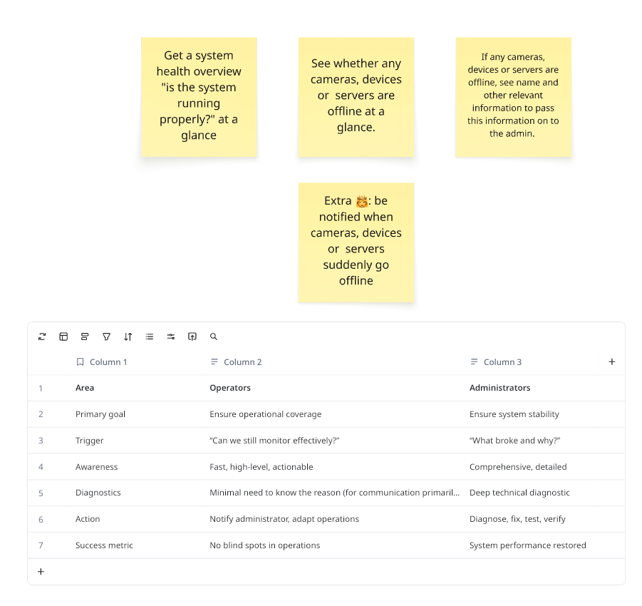

# Module 4: Build with Your AI Agent

**Duration:** ~55 minutes

**Goal:** connect your AI agent to Milestone's MCP server and agent skills, implement a real user story with it, and ship it to Smart Client as a new version.

Your app is already running in Smart Client from Module 3. Now you make it useful. Work in your project folder (e.g. `jd-health-dashboard/`), with `npm start` still running in `client/` so you can check each change at <http://localhost:3003>.

## The user stories

These stories come from Milestone's Operator value stream and are based on real user research.



As an **operator**, I want to...

1. ...get a **system health overview** at a glance: is the system running properly? ⭐ *Start here*
2. ...see whether any **cameras, devices or servers are offline**, at a glance.
3. ...see the **name and other relevant details** of anything offline, so I can pass it on to the administrator.
4. *Stretch 👑:* ...be **notified** when something suddenly goes offline.

**Remember who you're building for.** Operators want to know *"Can we still monitor effectively?"*. They need fast, high-level, actionable information, not deep diagnostics. That's the administrator's job.

## Step 1: Start your agent in the project

> ⚠️ **Skipped adding an AI agent in Module 1?** Do it now, before you continue:
>
> 1. [Add your AI agent](../module-1-setup/README.md#step-2-optional-add-your-ai-agent) to `.devcontainer/devcontainer.json` (Module 1, Step 2).
> 2. [Rebuild the dev container](../module-1-setup/README.md#step-3-rebuild-and-reopen-in-the-dev-container) (Module 1, Step 3).
> 3. [Log in to your agent](../module-1-setup/README.md#step-4-log-in-to-your-agent) (Module 1, Step 4).
> 4. Rebuilding removes your npm login, so run `npm-auth` again ([Module 1, Step 5](../module-1-setup/README.md#step-5-authenticate-npm)). Rebuilding also stops `npm start`, so start it again in `client/`.
>
> Your project files and your app on the App Platform are kept. They live in your workshop folder and on the platform, not in the container.

Your project comes with two things your agent should use:

- **MCP servers**: the Milestone App Platform knowledge server (`@milestone/app-platform-knowledge-mcp-server`), which searches the Milestone developer documentation, and the MUI server for MUI component docs. They're configured in `.mcp.json` and `.vscode/mcp.json`.
- **Milestone agent skills** in `.github/skills/`: MFE federation, the Milestone look & feel, and how to use the Milestone MCP server. `npm install` put them there in Module 2.

Not every agent reads these files, so some need a one-time setup. The workshop folder also has MCP config for Codex, Gemini CLI and OpenCode, which they pick up from there. Open a **new terminal**, go to your project folder, then follow the steps for your agent below:

```bash
cd jd-health-dashboard    # your app name
```

<details>
<summary><b>Claude Code</b></summary>

Claude Code reads `.mcp.json`, but it only loads skills from `.claude/skills/`, so install the skills there too:

```bash
npx -y -p @milestone/agent_skills milestone-skills install --location .claude/skills
claude
```

Trust the folder and **approve the project's MCP servers** when asked. Check with `/mcp` and `/skills`.

</details>

<details>
<summary><b>GitHub Copilot CLI</b></summary>

Copilot CLI reads `.mcp.json` and `.github/skills/` as they are. Nothing to set up:

```bash
copilot
```

**Trust the folder** when asked. Copilot CLI skips the project's MCP servers in folders you haven't trusted. Check with `/mcp list` and `/skills list`.

</details>

<details>
<summary><b>OpenAI Codex</b></summary>

Codex picks up the MCP servers from the workshop folder's `.codex/config.toml`. It loads skills from `.agents/skills/`, so install them there:

```bash
npx -y -p @milestone/agent_skills milestone-skills install --location .agents/skills
codex
```

**Trust the project** when asked. Codex only loads `.codex/config.toml` in trusted projects. Check with `/mcp` and `/skills`.

</details>

<details>
<summary><b>Gemini CLI</b></summary>

Gemini CLI picks up the MCP servers from the workshop folder's `.gemini/settings.json`. It loads skills from `.agents/skills/` (or `.gemini/skills/`), so install them there:

```bash
npx -y -p @milestone/agent_skills milestone-skills install --location .agents/skills
gemini
```

**Trust the folder** when asked. Gemini CLI only connects to the MCP servers in trusted folders. Check with `/mcp` and `/skills list`.

</details>

<details>
<summary><b>OpenCode</b></summary>

OpenCode picks up the MCP servers from the workshop folder's `opencode.jsonc`. It loads skills from `.agents/skills/` (or `.opencode/skills/`, `.claude/skills/`), so install them there:

```bash
npx -y -p @milestone/agent_skills milestone-skills install --location .agents/skills
opencode
```

Check the MCP servers with `opencode mcp list` in another terminal.

</details>

> 💡 The Milestone MCP server is installed from the `@milestone` npm registry when your agent starts it. If it fails to connect, your npm token has probably expired: run `npm-auth` and restart your agent.

Check that your agent can see the Milestone MCP server and skills by asking it:

> *"Which Milestone MCP tools and skills do you have? Then explain briefly how this MFE gets loaded by the shell."*

## Step 2: Write your prompt

Pick a story and fill in this template:

```markdown
I'm building an MFE for the Milestone XProtect App Platform, generated with create-mfe-app.
The entry component is client/src/App.tsx. It will run inside XProtect Smart Client.

User: <who they are and what they care about>
User story: As an operator, I want to <story>, so that <why>.
Acceptance criteria:
- <what the user sees / can do>
- <what happens when everything is fine, when something is wrong, and when data can't load>

Constraints:
- Use the Milestone MCP server to find the right APIs. Don't guess.
- Follow the Milestone look & feel: MUI components and Milestone design tokens.
- Read-only. Keep data access in a separate hook, with mock data for local development.

Ask me clarifying questions and show me a short plan before you write code.
```

<details>
<summary>Example: Story 1</summary>

```markdown
I'm building an MFE for the Milestone XProtect App Platform, generated with create-mfe-app.
The entry component is client/src/App.tsx. It will run inside XProtect Smart Client.

User: an XProtect operator in a control room. Not technical. Needs fast, high-level,
actionable information, and acts by notifying the administrator.
User story: As an operator, I want a system health overview at a glance,
so that I immediately know whether I have any blind spots.
Acceptance criteria:
- One clear overall status at the top: "All systems operational" or "Attention needed".
- One card each for Cameras, Devices and Servers, showing "<online> / <total> online".
- Refreshes every 30 seconds and shows when it was last updated.
- Shows a loading state, and a friendly error with a Retry button.

Constraints:
- Use the Milestone MCP server to find the right APIs. Don't guess.
- Follow the Milestone look & feel: MUI components and Milestone design tokens.
- Read-only. Keep data access in a useSystemHealth() hook, with mock data for local development.

Ask me clarifying questions and show me a short plan before you write code.
```

</details>
</br>

> 💡 **Which APIs give camera, device and server status?**
> 
>These are good places to start. Add the ones you use to your prompt:
>
> - **REST Config API**: the XProtect configuration, such as cameras, hardware and recording servers. See the [REST Config API reference](https://doc.developer.milestonesys.com/mipvmsapi/api/config-rest/v1/).
> - **Events and State WebSocket API**: live events and the current state of cameras, devices and servers, e.g. whether they're online or offline. See the [Events and State WebSocket API reference](https://doc.developer.milestonesys.com/mipvmsapi/api/events-ws/v1/).
> - **AI Bridge GraphQL API**: AI Bridge runs as the Processing Server on the App Platform. To browse its GraphQL API documentation, forward its port:
>
>   ```bash
>   kubectl port-forward -n processing-server svc/aibridge-webservice 4000:4000
>   ```
>
>   Then open <http://localhost:4000/>.
>
> **Or start with mock data.** You don't need the real APIs to build the UI. Have your agent mock them first, and add a way to switch between scenarios, so you can see how your app handles each one:
>
> - **Normal**: everything online.
> - **Flaky**: devices go offline and come back, or some requests fail now and then.
> - **Error**: the API can't be reached, or something is offline.
>
> For example, add to your prompt: *"Start with a mock implementation of the hook, with a scenario switch for normal, flaky and error, so I can test every state without a real system."* Swap in the real API later. The rest of the app doesn't change.

## Step 3: Plan, then build in small steps

1. Paste your prompt. Answer the agent's questions and review its plan before it writes code.
2. Let it build **one step at a time**. After each step, check the result in the browser.
3. Give specific feedback. *"Make the overall status bigger and use the success colour"* works better than *"make it nicer"*.
"..."`.

> ⏱️ After about 40 minutes, make sure you have something working to deploy. Polish can wait.

## Step 4: Ship your new version

From your project folder, bump the version and deploy:

```bash
task bump
task deploy
```

See **[🔁 Shipping a new version](../module-3-deploy/README.md#-shipping-a-new-version)** in Module 3 for what these do. Then open your MFE in Smart Client again and try it as an operator would.

> 💡 Ask your agent to read `../Taskfile.yml` and explain it, or to add a task of your own, e.g. one that also adds an entry to `docs/changelog.md`.

## Stretch goals

- **Story 4:** notify the operator when something goes offline.
- **Live updates:** let the Express server in `server/` push status changes to the MFE over a WebSocket.

## ✅ Done when

- [ ] Your agent can see the Milestone MCP server
- [ ] At least Story 1 works in the browser
- [ ] It looks like Milestone (MUI and design tokens, no hard-coded colours)
- [ ] Your new version runs in Smart Client

## Clean up

At the end of the session, uninstall your app in App Center, or run `task app:uninstall` (`app-builder uninstall`) in your project folder. The platform is shared.

## 🎓 Well done!

You've gone from an empty folder to an AI-built MFE running in Smart Client. Your project is yours to keep: try the stretch goals, or start something new with `npx @milestone/create-mfe-app`.

**Thank you for joining!** We'd love your feedback. Please tell an instructor what worked and what didn't.
