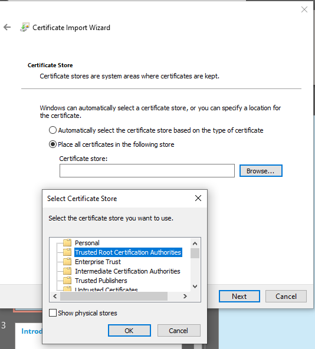

# Trusting the XProtect Root Certificate

To connect the Smart Client to XProtect using HTTPS, the Smart Client must trust the certificate used by the XProtect server. The server certificates are signed by the **XProtect Root Certificate Authority**, so this root certificate must be installed as trusted on your machine.

Certificate: [`XProtect-Root-Certificate-Authority.crt`](XProtect-Root-Certificate-Authority.crt)

## Windows

1. Download `XProtect-Root-Certificate-Authority.crt` and open it, then choose **Install Certificate…**
2. When prompted for the store location, choose **Local Machine**.
3. Choose **Place all certificates in the following store**, click **Browse…** and select **Trusted Root Certification Authorities**:

   

4. Click **Next** and **Finish**, and accept the security prompt.

After installing, **restart the Smart Client**. If it still reports certificate errors, restart the machine.

## Browsers

- **Google Chrome:**
  - On Windows, Chrome uses the Windows certificate store, so the steps above are enough. Fully close and reopen Chrome afterwards.
  - To check, open `chrome://certificate-manager` (or **Settings → Privacy and security → Security → Manage certificates**) and look for the certificate under **Trusted certificates / Local** (Windows root store).
  - On Linux (or if Chrome still warns), import it manually in Chrome's certificate settings under **Authorities → Import…** and tick **Trust this certificate for identifying websites**.
- **Edge:** also uses the Windows certificate store. Restart the browser.
- **Firefox:** uses its own store by default. Either:
  - Go to **Settings → Privacy & Security → Certificates → View Certificates → Authorities → Import…**, select the `.crt` file and tick **Trust this CA to identify websites**, or
  - Set `security.enterprise_roots.enabled` to `true` in `about:config` to make Firefox use the Windows store.

## Verify

Open [https://192.168.0.181/api/.well-known/uris](https://192.168.0.181/api/.well-known/uris) in a browser, or connect with the Smart Client. It must work **without any certificate warnings**.
